<h1 align="center">EchoTwin</h1>

<p align="center"><b>Your Android phone and your Linux laptop, working as one.<br>Directly between the two. No account, no cloud, nobody in the middle.</b></p>

<p align="center">
  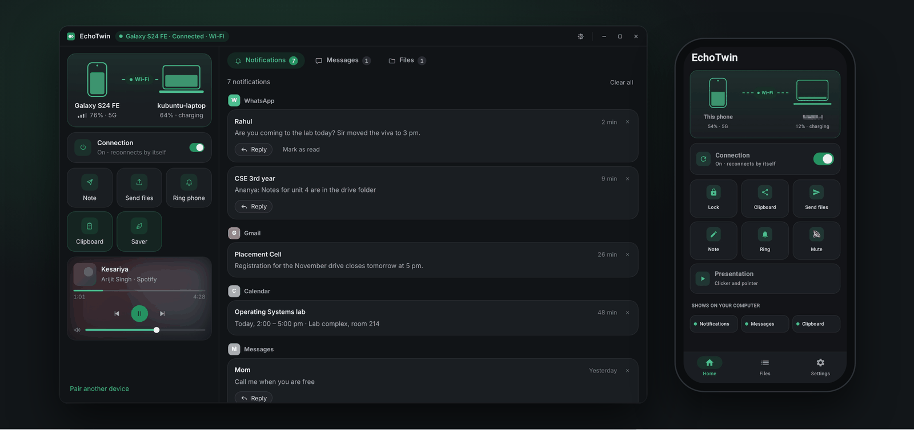
</p>

<p align="center">
  <b>Private</b> · paired by QR code, encrypted end to end &nbsp;|&nbsp;
  <b>Local</b> · over your Wi-Fi or hotspot, Bluetooth when Wi-Fi is gone &nbsp;|&nbsp;
  <b>Native</b> · a KDE Plasma panel widget, a desktop window and an Android app
</p>

---

Windows has Phone Link. Linux had nothing that felt like it, so this is that, built for
**KDE Plasma** and **Android**. The phone's notifications pop up on the laptop, you answer
your texts with a real keyboard, files fly both ways, and the phone becomes a remote for
the laptop: music, mute, and a presentation clicker with a pointer.

## A day with EchoTwin

### 💬 A message arrives

The WhatsApp message lands on the laptop as a normal KDE popup, **the whole message**, not
just its first line. Reply from the laptop, press the notification's own buttons ("Mark as
read"), or dismiss it on both devices at once. A bank OTP gets a **Copy 482913** button so
you never retype a code.

<p align="center">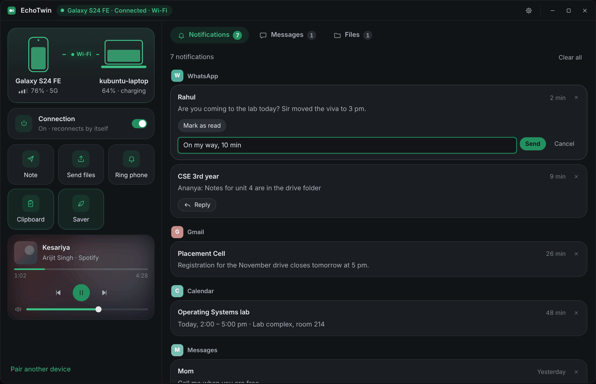</p>

### 📞 Your phone rings

Nothing on screen all day, until the phone rings. Then a card slides down at the top of the
laptop screen, even over a full-screen presentation, with **Answer** and **Decline**. Music
on the laptop pauses by itself. Answer, and the window and panel widget show the call:
how long it's been, plus **End**, **Mute** and **Speaker**, the same buttons your dialer
shows. The call itself stays on the phone.

<p align="center">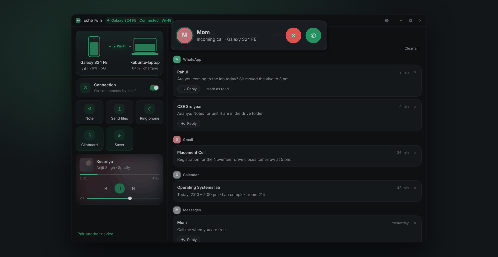</p>

### 🎤 You present

Open your slides, tap **Presentation** on the phone and pick the app: PowerPoint, Impress,
Google Slides, Canva or anything full screen. One button starts and ends the show, Next and
Previous are big enough to hit without looking, and the phone's volume keys work as a
clicker. Drag a finger on the touchpad and a **pointer** follows on the laptop screen: a
dot, a ring, or a spotlight that dims everything else.

<p align="center">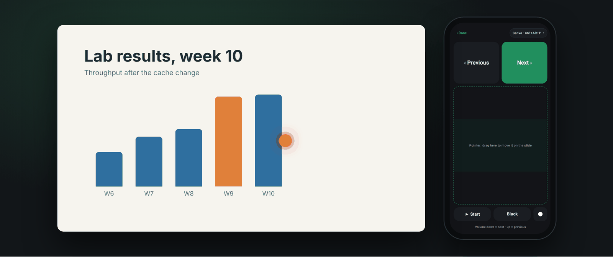</p>

<p align="center">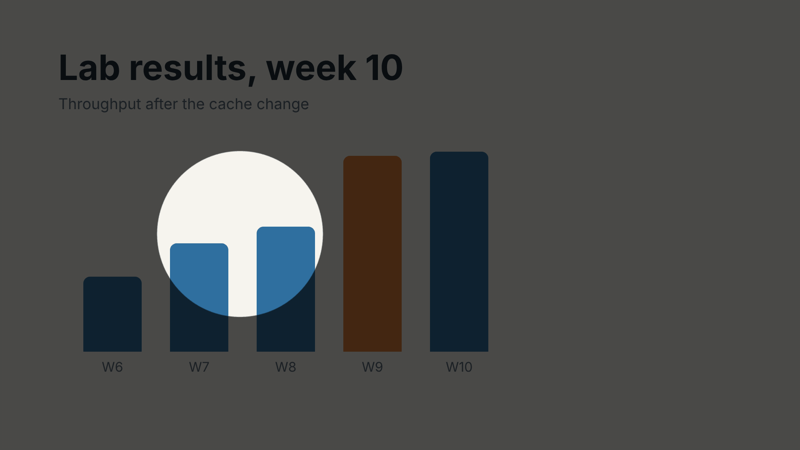</p>

### 📁 Files, clipboard and notes

Drag a file onto the window or the panel icon and it's on the phone. Share anything from the
phone and it's on the laptop. Big files survive a dropped connection and carry on where they
stopped. Copy text on one device, paste it on the other. Send a quick note either way, with
a **Copy** button on both ends.

<p align="center">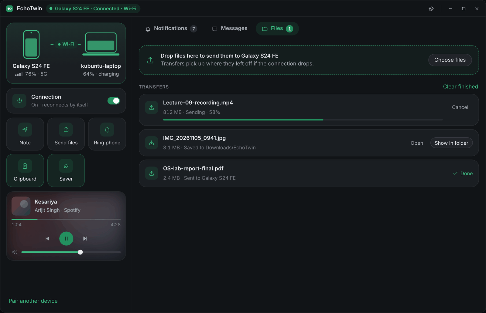</p>

### 🎵 Music, both ways

What plays on the phone shows on the laptop with its album art, volume and skip controls.
What plays on the laptop shows on the phone's Home screen, with the album cover behind it,
plus a **Mute** tile for the laptop and **My buttons** for your own one-tap commands
("Lab VPN", "Dim screen"…).

### 🔋 Always there in the panel

A little phone sits in your KDE panel: its battery, a badge for new things, a green handset
during a call. Click it for everything at a glance; drop files on it to send them.

<table>
  <tr>
    <td>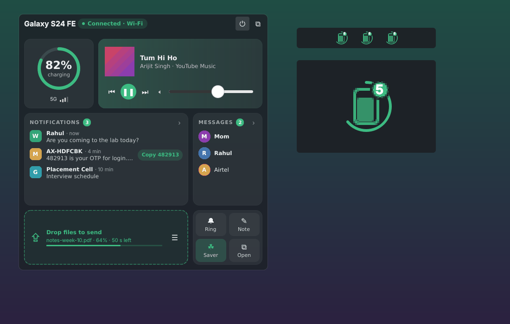</td>
    <td>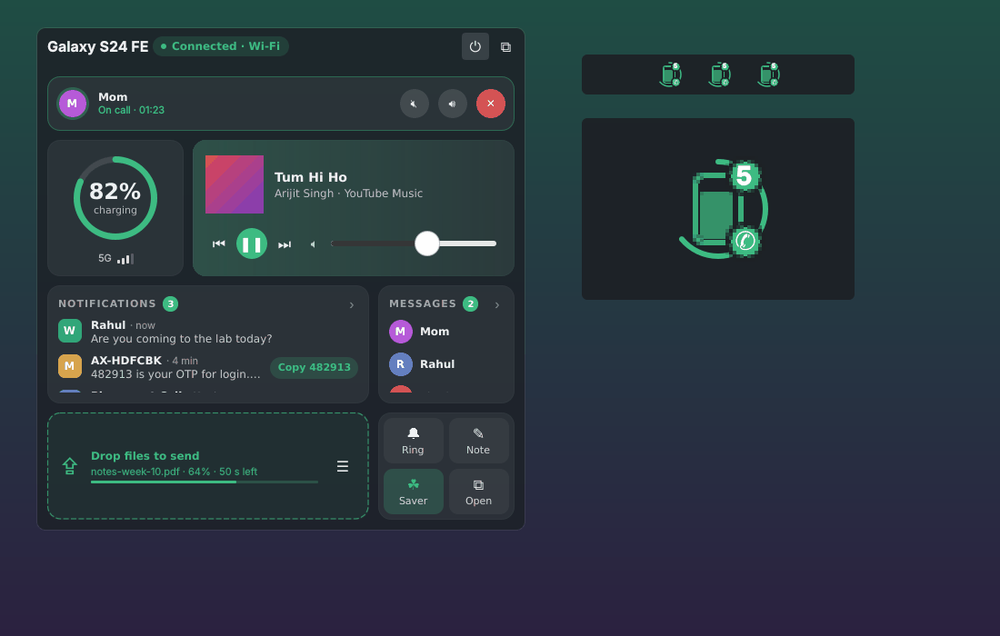</td>
  </tr>
  <tr>
    <td align="center"><sub>The widget popup</sub></td>
    <td align="center"><sub>…and during a call</sub></td>
  </tr>
</table>

### 📶 Wi-Fi drops

Train, hotspot off, router restarting: EchoTwin switches to **Bluetooth** by itself and
switches back when Wi-Fi returns. Messages sent while the devices were apart arrive later,
once each and in order.

## The phone app

Real screenshots. The Twin header draws both devices with their battery levels and the link
between them (green Wi-Fi, amber Bluetooth). Below it: lock the laptop, send the clipboard
or files, write a note, ring the laptop to find it, mute it, or start presenting.

<p align="center">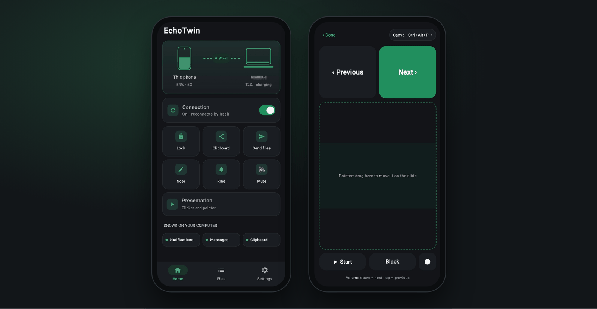</p>

## The laptop window

<table>
  <tr>
    <td>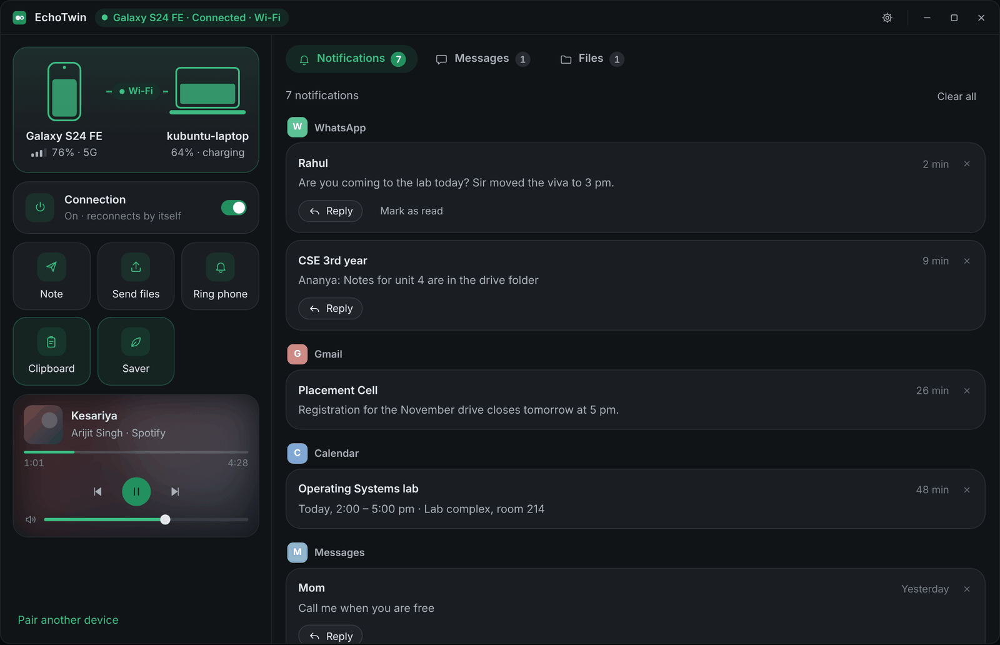</td>
    <td>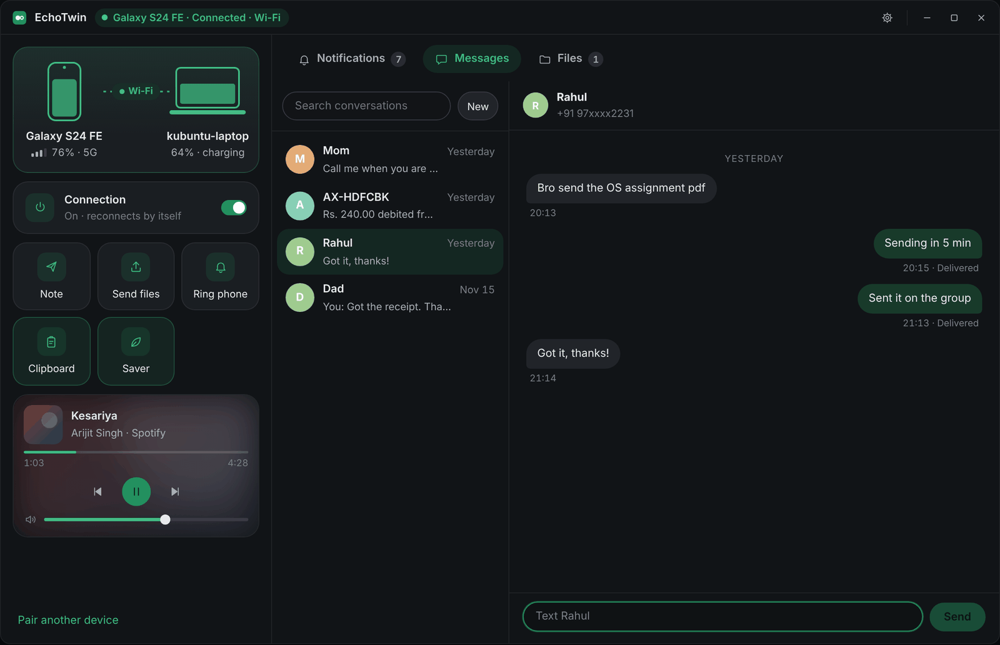</td>
  </tr>
  <tr>
    <td align="center"><sub>Notifications</sub></td>
    <td align="center"><sub>SMS, with contact names and new conversations</sub></td>
  </tr>
  <tr>
    <td>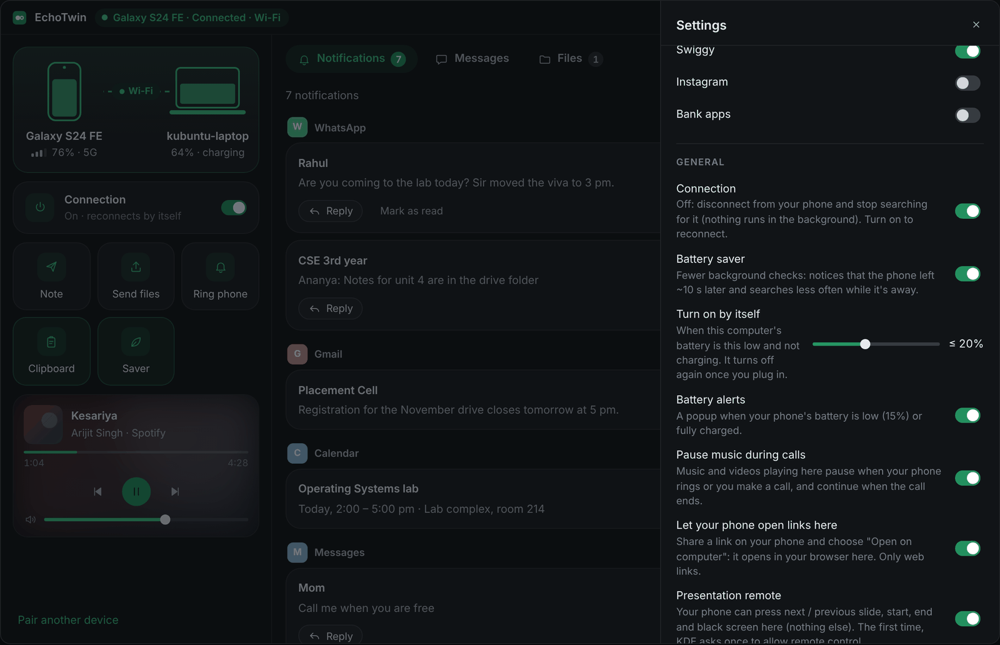</td>
    <td>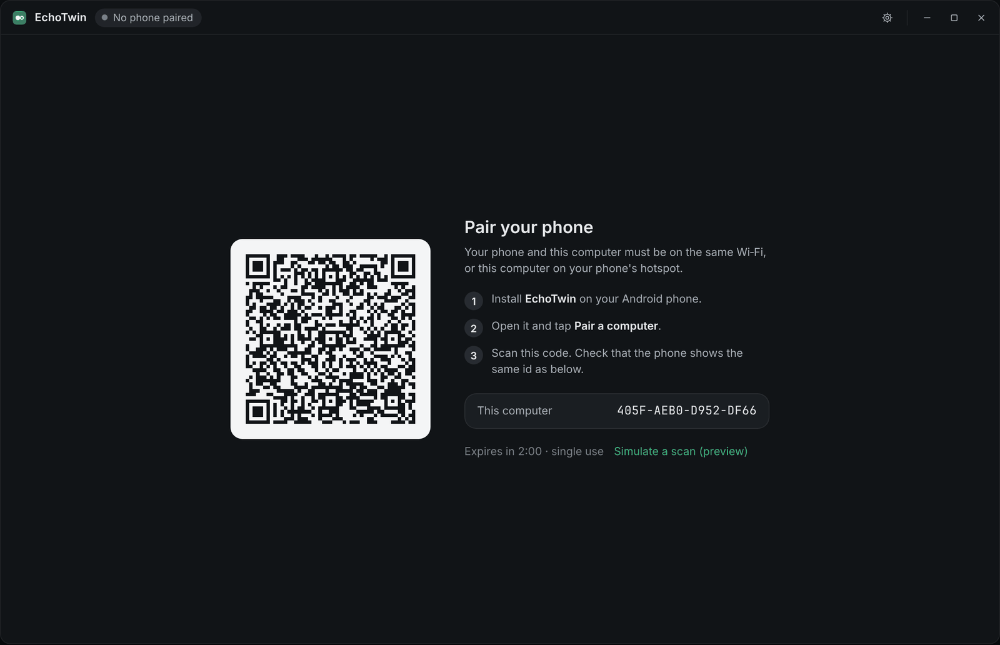</td>
  </tr>
  <tr>
    <td align="center"><sub>Settings: what the phone may do, your own buttons, the battery saver</sub></td>
    <td align="center"><sub>Pairing: scan once, done</sub></td>
  </tr>
</table>

## Everything it does

| | |
|---|---|
| **Notifications** | Popups with the full text, reply, the app's own buttons, dismiss on both devices, mute per app, OTP copy |
| **SMS** | Read and reply with contact names; start a new conversation with contact search |
| **Calls** | Card at the top of the screen with Answer / Decline; End, Mute, Speaker, Hold from the laptop; music pauses during calls |
| **Files** | Both ways, drag and drop, share sheet, Dolphin's right-click menu; resumes after drops; you choose the folder they land in, on each device |
| **Clipboard and notes** | Copy here, paste there; notes both ways with a Copy button |
| **Remote** | The laptop's music on the phone with album art; Mute; your own buttons |
| **Presentations** | Start/End per app (PowerPoint, Impress, Google Slides, Canva, full screen), Next / Previous, black screen, volume-key clicker, pointer |
| **Little things** | Lock the laptop from the phone (also a Quick Settings tile), ring a lost phone or laptop, open a link on the other device, battery alerts, phone battery and 5G/4G signal on the laptop |
| **Staying connected** | Reconnects after sleep, reboots and new IP addresses; Bluetooth backup; a battery saver that turns on by itself when the laptop runs low |

## Private by design

- **You pair once with a QR code.** From then on only that phone and that laptop can talk,
  and each checks the other's key on every connection (mutual TLS with pinned keys).
  A stranger on the same Wi-Fi can't connect, read anything, or even tell who you are.
- **No server exists.** Nothing goes through the internet, no account, no tracking. It works
  on a hotspot with no internet at all.
- **The laptop keeps your messages in memory only.** The phone asks only for what each
  feature needs; the camera is used for the QR scan and nothing else, and location never.

## Get started

On the laptop (Kubuntu, or any distro with KDE Plasma 6 and systemd):

```bash
git clone https://github.com/Yuvraj06Jain/EchoTwin.git ~/phonelink
```

```bash
cd ~/phonelink && ./packaging/install.sh
```

For the call card and the pointer on Wayland, also install:

```bash
sudo apt install libgtk-layer-shell-dev
```

On the phone (Android 10 or newer), download the APK from the
[latest release](https://github.com/Yuvraj06Jain/EchoTwin/releases/tag/latest-apk), open
EchoTwin on the laptop, scan the QR code, and follow the short setup checklist in the app.

Step-by-step setup, a test checklist and troubleshooting: **[SETUP.md](SETUP.md)**.

## Under the hood

- **Core** in Rust: QUIC over Wi-Fi and TLS over Bluetooth RFCOMM, mutual TLS with pinned
  keys, a durable outbox so messages survive restarts, mDNS discovery.
- **Laptop**: a small background service (`phonelinkd`) talking to KDE over D-Bus, a
  `phonelink` command line, a Tauri window, and a Plasma panel widget in QML.
- **Phone**: Kotlin and Jetpack Compose, using the same Rust core through UniFFI.

Read more: [architecture](docs/ARCHITECTURE.md) · [every feature and where it lives](docs/FEATURES.md) ·
[protocol](docs/PROTOCOL.md) · [developing and tests](docs/DEVELOPING.md) · [files](docs/FILES.md)

## Good to know

- Call audio stays on the phone; the laptop only presses the buttons.
- Album art from the laptop needs a player that shares a local picture (Firefox, Chrome, VLC
  do); Spotify doesn't.
- Canva's start shortcut comes from a third-party list; if it doesn't start, pick "Full
  screen" instead.
- If an app cuts its own notification short on the phone (Gmail does for long mails), that
  is all the laptop can show too.

<p align="center"><sub>Pictures of the laptop side are rendered from the app's own code with sample data; the phone pictures are real screenshots. License: GPL-3.0.</sub></p>
