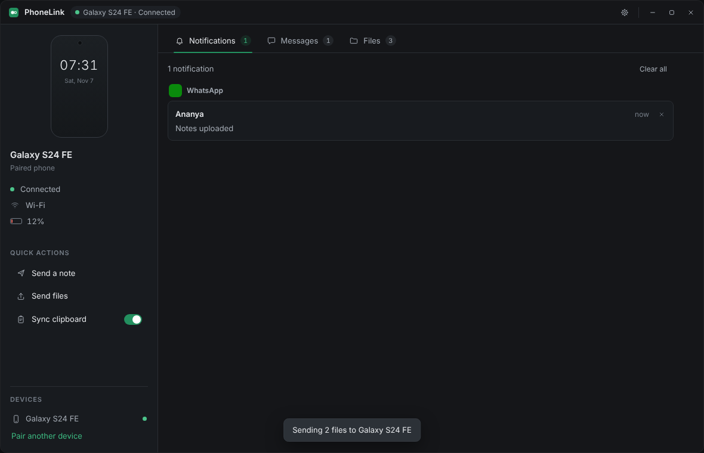
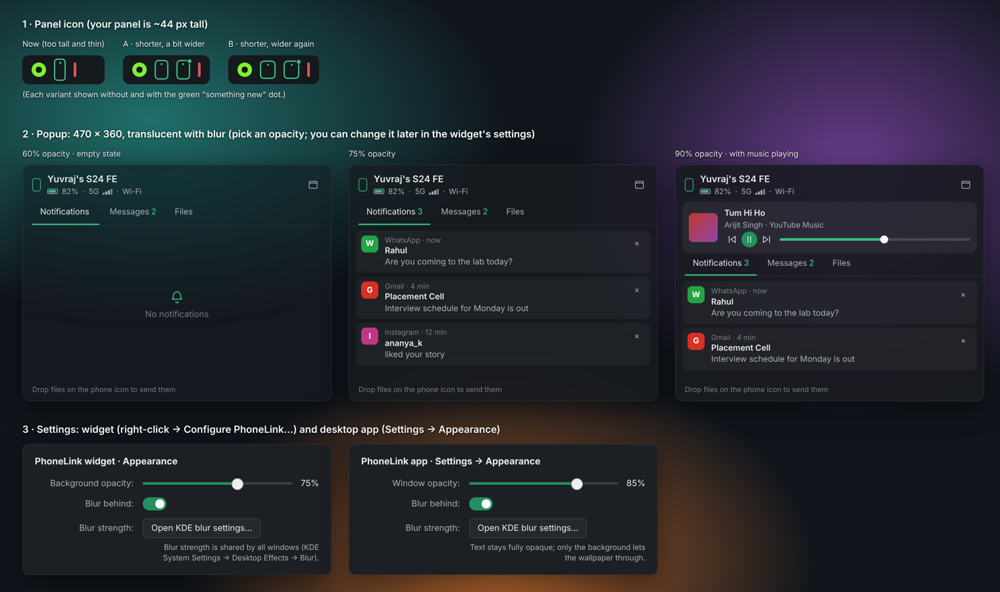

# PhoneLink

A private, Phone Link–style bridge between a Linux laptop (KDE Plasma) and an Android phone.
No accounts, no cloud: the two devices talk directly over your Wi-Fi or hotspot (with a
Bluetooth backup), encrypted end to end, and only with each other.

**Version 1 is complete.** New here? Start with **[SETUP.md](SETUP.md)** (install, pair,
test checklist, troubleshooting).



## What it does

| Feature | Phone → laptop | Laptop → phone |
|---|---|---|
| **Notifications** | popups + list; reply, press buttons, dismiss (optionally on both); mute apps; not queued while away (switchable) | — |
| **SMS** | conversations with contact names, older messages | reply / send, Sending → Sent / Failed |
| **Files** | Share → PhoneLink, "Send files" | drag onto the window or panel widget, Dolphin "Send to phone", `phonelink send-file`; resumes after drops and restarts, verified |
| **Clipboard** | one tap (button, tile, share) | automatic (password-manager copies excluded) |
| **Music** | — | now playing card with previous / play-pause / next / volume |
| **Lock** | lock the laptop (button, Quick Settings tile) | — |
| **Notes** | short texts | short texts |
| **Status** | battery, charging, 5G/4G/Wi-Fi + signal | laptop battery |
| **Connection** | reconnects by itself after reboots, new IPs and sleep; Bluetooth backup when Wi-Fi is gone | |

On the laptop it runs as a background service (`phonelinkd`) with a window (PhoneLink app), a
**KDE panel widget** (a small green phone; click for notifications, SMS, files and music; drop
files on it) and a CLI (`phonelink`). The phone app is a dark Compose app with Home, Files and
Settings.



## Privacy in one paragraph

Only the phone you paired (by scanning a QR code shown on the laptop) can connect: both
devices pin each other's keys and refuse everyone else inside the TLS handshake. Nothing
identifying is broadcast on the network. The laptop keeps notification, SMS and clipboard
content in memory only. The phone app never asks for microphone, location or storage, uses
the camera only for the pairing scan, and CI fails the build if a forbidden permission ever
appears. Details: [ARCHITECTURE.md §8](docs/ARCHITECTURE.md#8-security-and-privacy-where-each-guarantee-is-enforced).

## Quick start

```bash
git clone https://github.com/Yuvraj06Jain/Phone-Link.git && cd Phone-Link
./packaging/install.sh        # builds, installs for your user, starts phonelinkd
```

Phone: download `PhoneLink-<commit>.apk` from
**[Releases → latest-apk](https://github.com/Yuvraj06Jain/Phone-Link/releases/tag/latest-apk)**,
install it, open PhoneLink → scan the code from the PhoneLink window (or `phonelink pair`).
Then tap **Finish setup** in the app. Full steps: [SETUP.md](SETUP.md).

Update later: `git pull && ./packaging/install.sh` on the laptop; the APK is rebuilt on
GitHub on every change (or Actions → Android APK → Run workflow).

## Documentation

| Read | When you want to… |
|---|---|
| [SETUP.md](SETUP.md) | install, pair, test on your devices, fix problems |
| [docs/ARCHITECTURE.md](docs/ARCHITECTURE.md) | understand how the pieces fit, how a message travels, connection/reconnect, security |
| [docs/FEATURES.md](docs/FEATURES.md) | see how one feature works and exactly which files/functions implement it |
| [docs/FILES.md](docs/FILES.md) | find what any file in the repo does |
| [docs/PROTOCOL.md](docs/PROTOCOL.md) | look up messages, capabilities, limits, and the rules for changing them |
| [docs/DEVELOPING.md](docs/DEVELOPING.md) | build, test, debug, add a feature or permission, CI and the APK |

## Repository layout

```
core/            Rust core shared by laptop and phone (identity, pairing, TLS, QUIC, outbox, files)
core-ffi/        Kotlin bindings for the core (UniFFI)
desktop/daemon/  phonelinkd service + phonelink CLI
desktop/app/     PhoneLink window (Tauri)
desktop/ui/      the window's HTML/CSS/JS (+ browser tests)
android/         phone app (Kotlin, Compose)
packaging/       install.sh, systemd unit, KDE panel widget, Dolphin menu
scripts/         APK build, bindings generation, permission audit
docs/            documentation
```

## Not in v1

Alarms and reminders to the Samsung Clock/Reminders apps, RCS chats (not readable by
third-party apps), MMS pictures, starting a new SMS conversation, internet (non-LAN) access.
